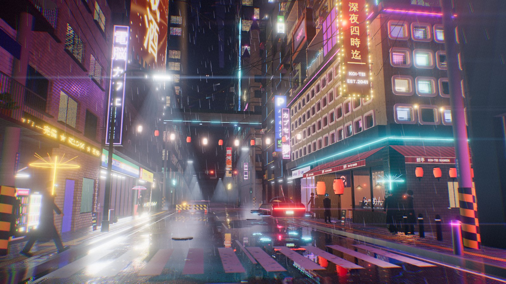
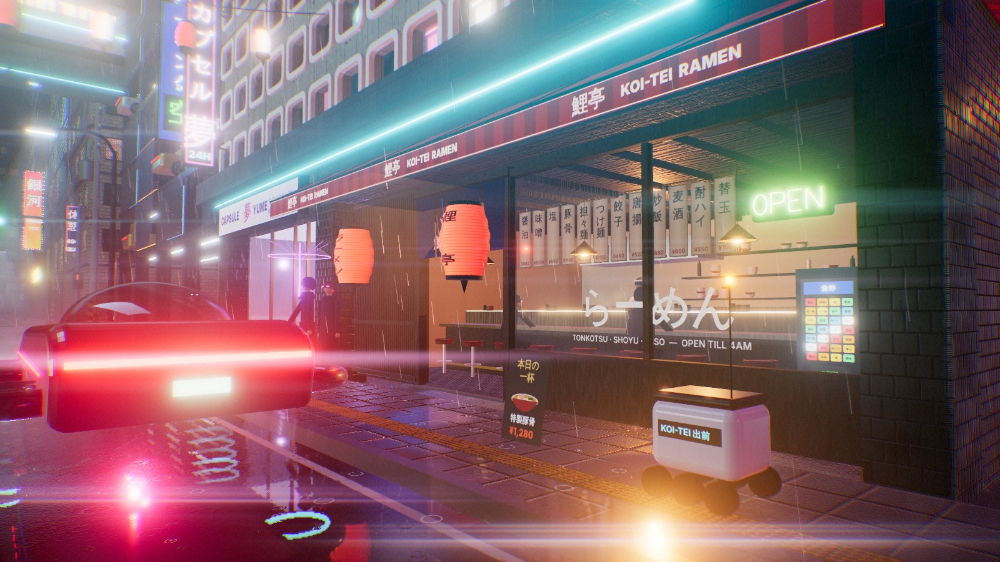
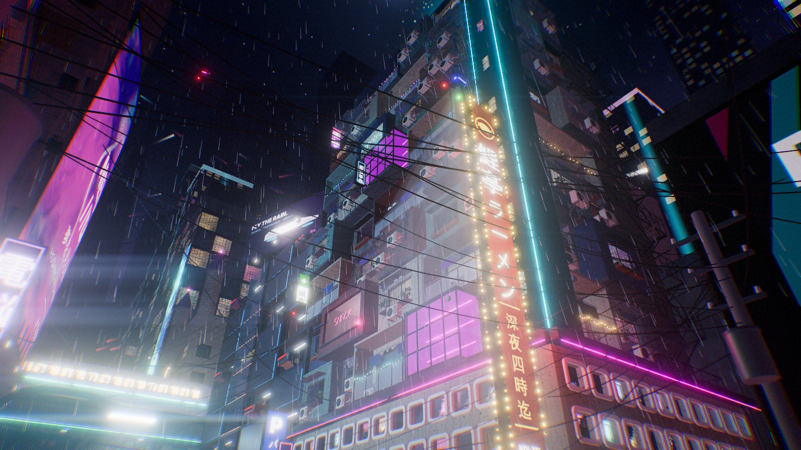
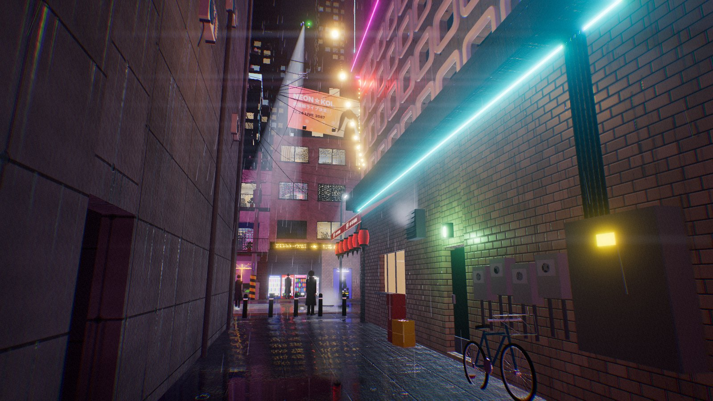
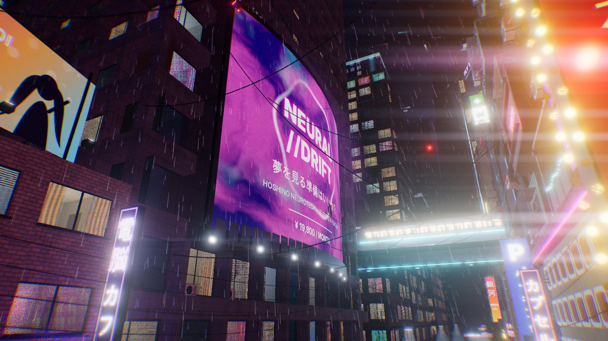
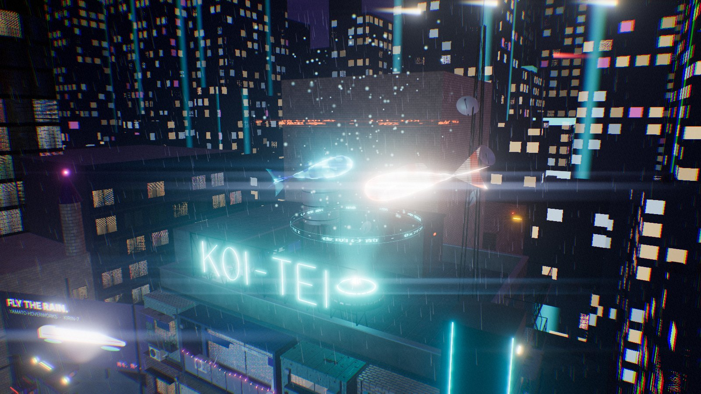
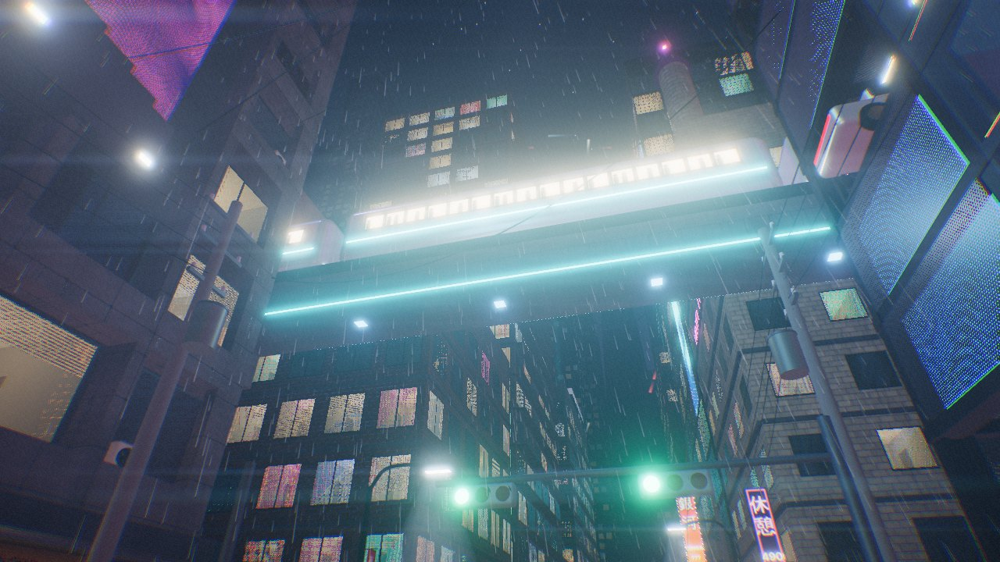

# KOI-TEI BLOCK · 鯉亭ビル

**One rain-soaked corner of Neo-Kabukichō, Sector 7: a hand-built, real-time 3D cyberpunk city block.**



I didn't build a whole city out of copy-pasted boxes. I picked one street corner and designed every object on it. The centrepiece is the **KOI-TEI tower**: a ramen counter at street level, a capsule hotel above it, eight floors of residential add-on modules, and a hologram of two koi circling the roof. The whole block is rendered live in the browser with wet-street reflections, neon, rain and a cinematic camera.

| | |
|---|---|
|  |  |
|  |  |
|  |  |

---

## Run it

The whole scene compiles into **one self-contained file**, `docs/index.html` (about 1 MB). It has no external assets, textures, fonts or CDNs.

* **Just open it:** double-click `docs/index.html` in a recent Chrome, Edge, Firefox or Safari.
* **GitHub Pages:** in the repository settings, choose *Pages → Deploy from branch → `/docs`*.
* **Develop:**
  ```bash
  npm install
  npm run dev     # live rebuild + http://localhost:8080
  npm run build   # writes docs/index.html
  ```

### Controls

| Input | Action |
|---|---|
| drag / right-drag / wheel | orbit / pan / zoom |
| `1`–`8` or the shot bar | jump to a composed camera shot |
| `C` | cinematic auto-tour (slow dolly moves with hard cuts; on by default) |
| `R` | toggle rain |
| `H` | hide the HUD |
| *Quality* button | Ultra / High / Medium / Low (the scene steps down by itself on slow GPUs) |

URL options: `?shot=ramen`, `?q=low`, `?rain=0`, `?hud=0`.

---

## What's in the block

**KOI-TEI tower 鯉亭ビル** (the hero, east corner)
* **Ramen counter:** kōshi wooden lattice lit from behind through frosted glass, indigo noren curtains that sway in the wind, a pair of chōchin lanterns, and a backlit red awning. Bent-glass neon spells *RAMEN* next to a ramen-bowl pictogram. Inside: an L-counter with eight chrome stools, two late customers, the chef working three stockpots on blue gas rings with steam rising, a noodle boiler, twelve hanging wooden menu tags, a shokkenki ticket machine, shelves of bowls and bottles, and a waving maneki-neko.
* **Capsule hotel 夢 YUME:** 92 rounded porthole pods. Each one has its own light colour, sleeper silhouette, half-drawn blind or flickering wall TV. The lobby has shoe lockers, a reception desk with a hologram glyph, and a lavender ceiling glow.
* **Eight floors of add-on modules,** laid out floor by floor by hand rather than generated at random: window cages with potted plants and laundry, balconies with fairy lights and folding chairs, a magenta hydroponic greenhouse, AC-condenser clusters, a *SNACK* bar and a *KARAOKE* box behind neon. Also projecting light boxes for an acupuncturist, a detective agency and a mahjong parlour.
* **A 15 m 鯉亭ラーメン blade sign** with chaser bulbs, plus a switch-back fire escape with a drop ladder, the rooftop *KOI-TEI* neon on a steel lattice, a water tank, a lattice mast with an aviation beacon, and the **koi hologram**: two swimming koi (kōhaku and asagi) with a scan-line fresnel shader, rotating glyph rings, a light column and data sparkles.

**Hoshino Residential Block 7 星野** (west): a 57 m brutalist slab with a board-formed concrete egg-crate façade. On it hangs the curved **NEURAL//DRIFT LED screen**. Three procedural ads rotate with a datamosh glitch between them, and RGB sub-pixels show up when you get close. A RectAreaLight follows the screen's colour, so the wet street and the tower opposite change colour with it. At street level: the NEKOMART 24 konbini (fridges, gondola shelves, oden, a cat outside), a loud yellow 薬 drugstore with goods spilling onto the pavement, and a monumental lobby portal with a neon "7".

**The neighbours,** each with its own concept:
* **AUTO-PARK 88:** a robotic parking stack with a glass lift that carries a car up and down.
* **NET CAFE ZERO-ONE:** a vending-machine alcove, an LED dot-matrix ticker, and a rooftop idol billboard.
* **JUNK 修理:** a half-open shutter with a green-lit electronics den behind it and CRTs showing static.
* **ROBATA 炉端:** a red-lantern izakaya with shoji, sake barrels and beer-crate seating, under the "Maison Nakano" flats.
* **GAME ZONE ∞:** a crane-game arcade with pixel light bars and neon *GAME*.
* **A tired walk-up** that closes off the back alley.

**Street and district:** a Japanese utility pole with a transformer and a web of sagging cables, curved LED street lamps with volumetric cones, festival lanterns strung across the street, a 止まれ road marking, tactile paving, design manholes with a koi motif, road works, a delivery robot, the parked **KIRIN-7 hover car**, and pedestrians under LED-shaft umbrellas. Further out:
* a cross street with signals and pedestrian lights;
* an elevated **maglev line** whose train passes overhead;
* HOTEL LUNA, a glass office slab, a PACHINKO 銀河 palace and a tiny Inari shrine;
* the city, the flying-car lanes and the distant **Tenkū Spire**, fading into fog.

---

## How it's made

* **Three.js r187.** ES modules bundled by esbuild into a single HTML file (`build.mjs`).
* **No image assets.** Every texture is painted procedurally at boot (`src/core/textures.js`), including tileable concrete with form joints and rain streaks, glazed mosaic tiles, asphalt with tar snakes, pavers, tenji blocks, wood and rusty corrugated metal. Each comes with albedo, roughness and bump maps. Signs are painted on canvases with their own typography.
* **Real neon.** Glyphs are hand-defined stroke paths, swept into tubes with filleted bends, electrode returns, standoffs and a blurred light spill on the wall (`src/core/neon.js`).
* **Interior-mapped windows.** About 2,000 instanced panes, each ray-marching a fake room behind the glass: walls, floor, ceiling-lamp falloff, furniture silhouettes, curtains, blinds and flickering TVs. The glass stays a reflective PBR surface. All of it is one draw call (`src/core/windows.js`).
* **Wet ground.** A planar reflector plus a shader with procedural puddles (mirror-sharp), anisotropic vertical streaks on damp asphalt, and animated raindrop ripples that bend both the normals and the reflections (`src/world/ground.js`).
* **Lighting.** About 30 coloured point lights, spot lights and RectAreaLights, all placed where real sources are: signs, shopfronts, lamps, the screen, the hologram and the passing train. There are shadow-casting spots from the ramen doorway and a street lamp, a scene-captured PMREM environment for glass and car paint, and a violet sky dome with lit clouds and searchlights.
* **Post-processing.** HDR bloom, anamorphic streaks, chromatic fringing, a split-tone grade, ACES tonemapping and film grain (`src/fx/post.js`).
* **Atmosphere.** 16k rain streaks that pick up the colour of nearby neon, splash crowns, steam plumes from kitchens, manholes and cooling towers, volumetric light shafts, and drones including a police searchlight (`src/fx/atmosphere.js`).
* **Performance.** Geometry is merged per material (`Batch`), props are stamped from prefabs, and the scene runs about 2–3k draw calls including the reflection and shadow passes. The quality level steps down automatically.

```
src/
  core/     utils · textures · materials · neon · windows · facade · prefabs
  world/    layout · ground · sky · heroTower · ramen · megablock · ledScreen
            neighbors · vehicles · district · props · figures · signs
  fx/       post · atmosphere · hologram
  ui.js     director: shots, cinematic tour, HUD
  main.js   boot, lighting, environment, quality, loop
tools/shot.mjs   headless render check (Playwright)
```

All names, brands, ads and characters in the scene are fictional.
